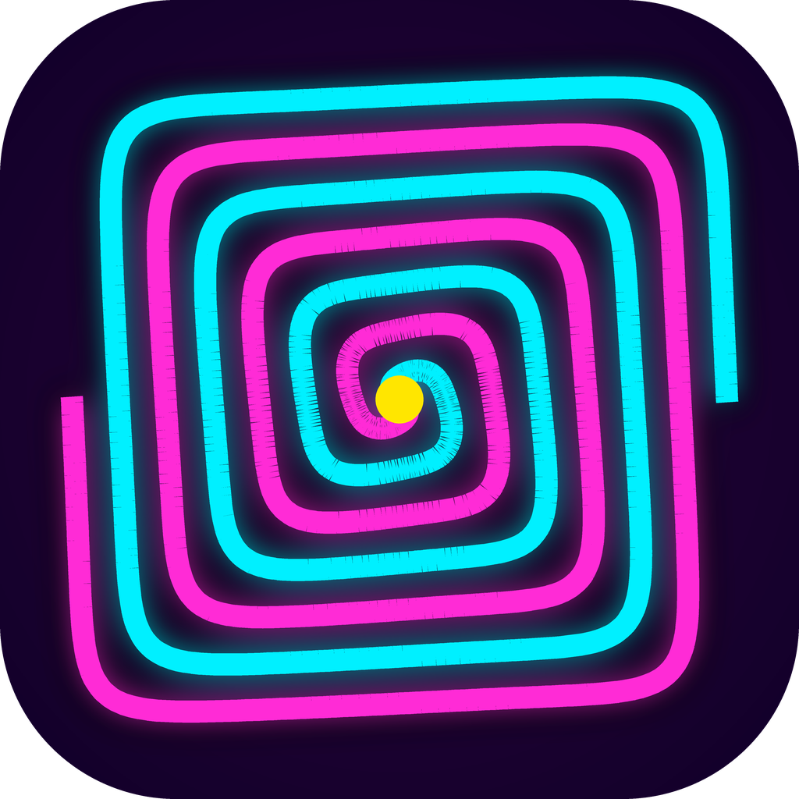
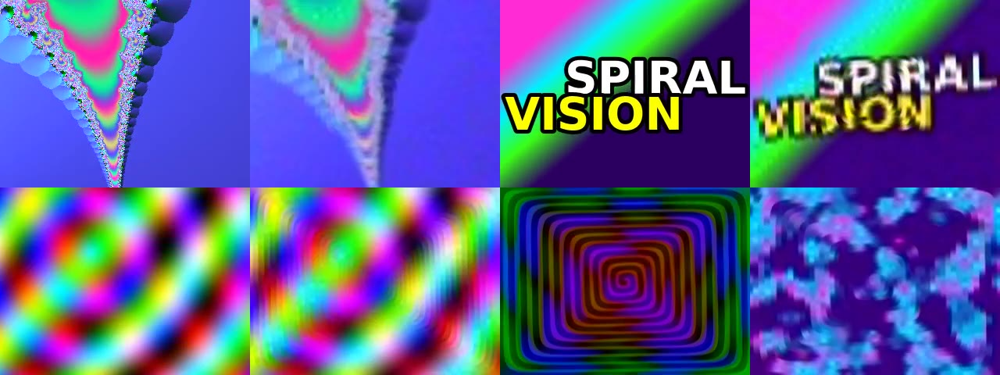
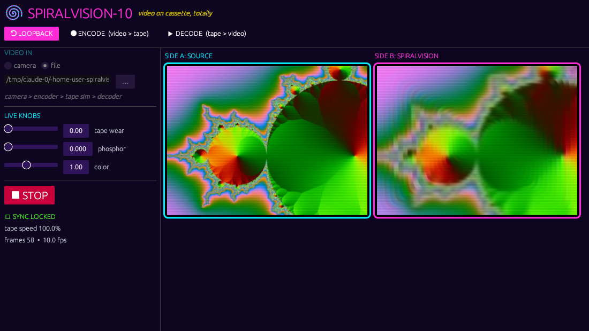

#  SPIRALVISION-10

[](https://github.com/sloev/spiralvision/actions/workflows/ci.yml)
[](https://github.com/sloev/spiralvision/releases/latest)

**YO!!!** 10 fps colour video crammed into a plain **stereo audio** signal. Dub it to a **cassette**. Rewind. Play. Watch it come back as a **NEON SPIRAL**. Tracking error? **That's art, dude.**

### ▶ [TRY IT IN YOUR BROWSER — sloev.github.io/spiralvision](https://sloev.github.io/spiralvision/)


<sub>Top: original / SpiralVision (worn tape) pairs. Bottom right: noise mode — audio without any video turned into spiral noise.</sub>

## What's on the tape

| | |
|---|---|
| **Geometry** | Two interlaced Archimedean spiral arms morphing from circle to 4:3 superellipse — uniform sample density |
| **Luma** | FM, 3 kHz (black) → 12 kHz (white) — shrugs off hiss and level wobble |
| **Chroma** | AM: U on the left channel, V on the right |
| **Sync** | 1 kHz pulse per frame + a **flywheel clock**: exactly 10 fps out, whatever goes in |
| **Calibration** | Two-level 2.5→13 kHz chirp every frame → decoder learns your tape's gain, treble loss and saturation |
| **Noise mode** | No sync? The flywheel free-runs and paints any audio (noise, music, a blank tape) as spiral noise |

Full spec: [spec.md](spec.md).

### Cassette survival (PSNR vs. original, higher = better)

Measured with `examples/eval` through the built-in cassette simulator (wear = 1: 1.2% slow, wow & flutter, HF loss, azimuth error, saturation, hiss, hum, dropouts):

| clip | v0.1 clean | **v0.2 clean** | v0.1 worn tape | **v0.2 worn tape** |
|---|---|---|---|---|
| test pattern | 4.5 dB | **15.1 dB** | 5.3 dB | **14.7 dB** |
| mandelbrot | 11.1 dB | **18.7 dB** | 7.3 dB | **18.1 dB** |
| photo | 17.0 dB | **19.0 dB** | 11.1 dB | **17.8 dB** |

## Get it on every deck

One Rust DSP core ([`crates/spiralvision-core`](crates/spiralvision-core), zero dependencies) powers everything:

| Platform | What | Download |
|---|---|---|
| 🌐 Web / PWA | WebAudio + the core compiled to WebAssembly. Installable, works offline | [sloev.github.io/spiralvision](https://sloev.github.io/spiralvision/) |
| 🍓 Raspberry Pi | 64-bit Pi OS desktop app + headless CLI | [`spiralvision-linux-aarch64.tar.gz`](https://github.com/sloev/spiralvision/releases/latest/download/spiralvision-linux-aarch64.tar.gz) |
| 🐧 Linux | AppImage (x86_64) | [`SpiralVision-x86_64.AppImage`](https://github.com/sloev/spiralvision/releases/latest/download/SpiralVision-x86_64.AppImage) |
| 🪟 Windows | .exe | [`spiralvision-windows-x86_64.zip`](https://github.com/sloev/spiralvision/releases/latest/download/spiralvision-windows-x86_64.zip) |
| 🍎 macOS | universal .app (unsigned: right-click → Open) | [`SpiralVision-macos-universal.zip`](https://github.com/sloev/spiralvision/releases/latest/download/SpiralVision-macos-universal.zip) |
| 🤖 Android | the web deck bundled offline in a WebView | [`SpiralVision-android.apk`](https://github.com/sloev/spiralvision/releases/latest/download/SpiralVision-android.apk) |

Desktop and CLI builds use **ffmpeg** (on your `PATH`) for cameras and video files.



## Taping it for real

1. **Encode:** desktop app → ENCODE, or `spiralvision-cli encode clip.mp4 side-a.wav`. Play it into the deck's line in and hit REC. Chrome (Type II) tape, record level peaking around 0 VU, Dolby **off**.
2. **Decode:** deck line out → computer line in. Desktop app → DECODE, the web deck, or
   `spiralvision-cli decode -f alsa default rewind.mp4`. Turn off any "voice processing" / AGC on the input.
3. Slow/fast decks (±8%), 44.1 kHz captures, wow & flutter, dropouts and splices are handled automatically.

## CLI

```bash
spiralvision-cli encode    <video-in> <audio-out.wav>  [--tape <wear>] [-t secs]
spiralvision-cli decode    <audio-in> <video-out>      [--persistence 0.5] [--mux]
spiralvision-cli roundtrip <video-in> <video-out.mp4>  [--tape 1] [--wav tape.wav] [--mux]
spiralvision-cli bench     <video-in>                  [--tape 1]

# camera -> line out (Raspberry Pi, headless)
spiralvision-cli encode -f v4l2 /dev/video0 default -F alsa
# line in -> v4l2loopback virtual webcam
spiralvision-cli decode -f alsa default /dev/video10 -F v4l2
```

## Build from source

```bash
# Linux deps (Debian/Ubuntu/Pi OS)
sudo apt install -y ffmpeg libasound2-dev libwayland-dev libxkbcommon-dev libegl1-mesa-dev libfontconfig1-dev

cargo run --release                       # desktop app (optionally: cargo run --release -- clip.mp4)
cargo run --release -p spiralvision-cli   # CLI
cargo test --workspace --release          # DSP + tape + frame-rate tests
./scripts/build-wasm.sh                   # core -> docs/wasm/spiralvision.wasm
./scripts/make-demos.sh                   # regenerate docs/videos
gradle -p android assembleDebug           # Android APK (needs the Android SDK)
```

Repository layout:

```
crates/spiralvision-core   the codec: encoder, flywheel decoder, tape simulator (no deps)
crates/spiralvision-cli    headless encode/decode/bench via ffmpeg
crates/spiralvision-wasm   C-ABI WebAssembly bindings used by the web + Android app
src/                       egui desktop app (Linux, Raspberry Pi, Windows, macOS)
docs/                      GitHub Pages site + PWA web deck (serve /docs)
android/                   WebView wrapper bundling docs/ into an APK
```

### Virtual webcam (Linux)

```bash
sudo apt install -y v4l2loopback-dkms
sudo modprobe v4l2loopback devices=1 video_nr=10 card_label="SpiralVision" exclusive_caps=1
```

Be kind, rewind. ⟲
